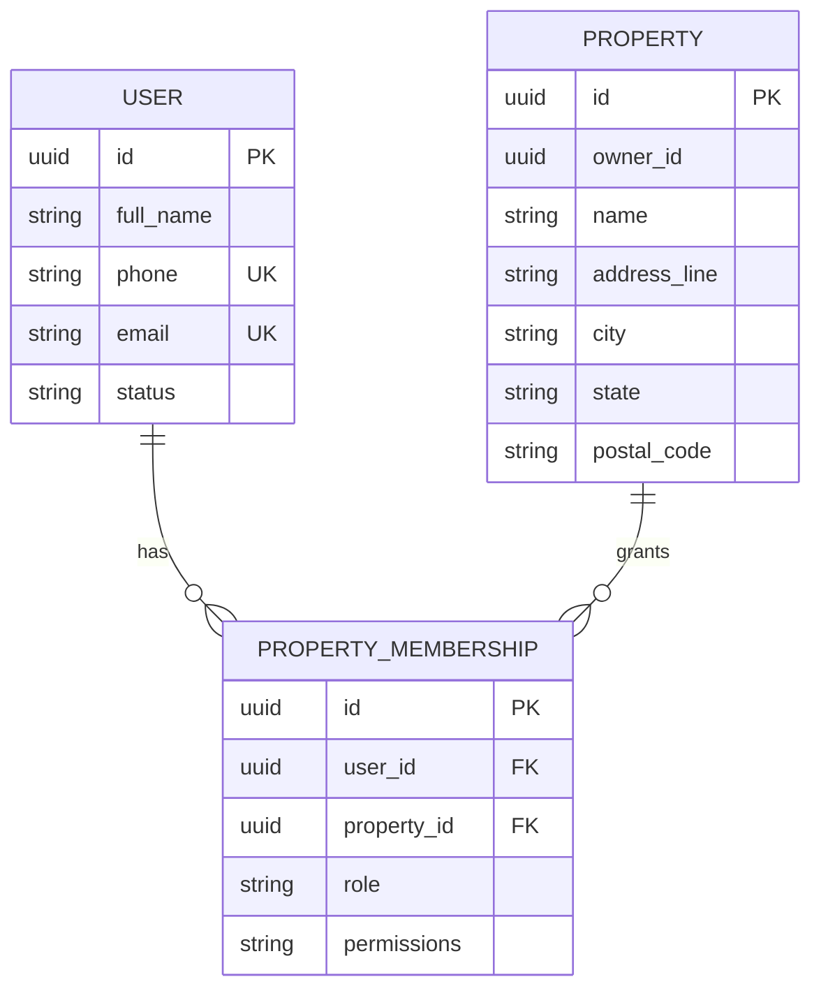

# Rentro — Database ERM

The initial Prisma schema defines users, properties and property memberships. Extend it with units, tenants/occupancies, agreements, rent schedules, rent invoices, payment attempts, payment transactions, rewards ledger, notifications, refresh-token sessions and audit events as each feature is implemented.

